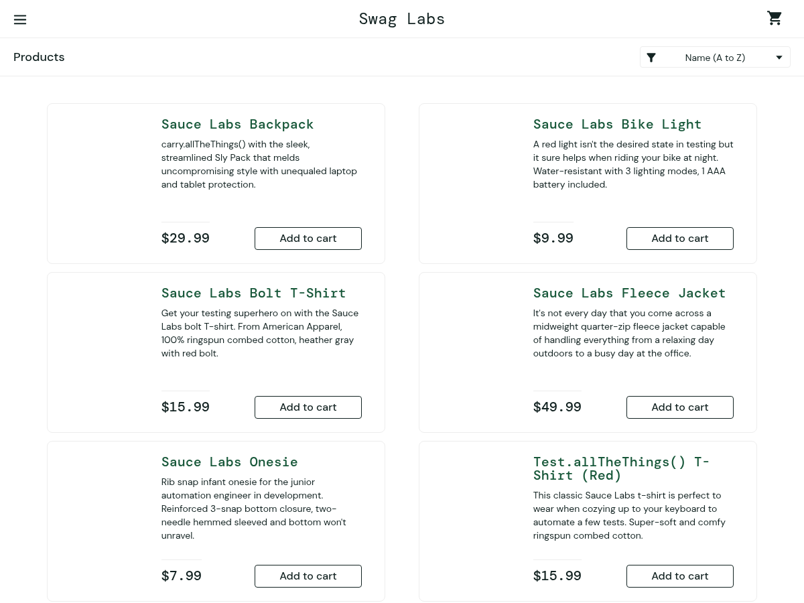

# SauceDemo test plan

Manual test cases and bug reports for the practice shop [saucedemo.com](https://www.saucedemo.com).

- [test-cases.md](test-cases.md) (same list as [test-cases.csv](test-cases.csv)): 37 test cases for login, inventory, cart, checkout, menu and the special test users
- [bug-reports.md](bug-reports.md): 3 bugs I reproduced, with steps and screenshots

## Status of the test cases

The "Status" column says how each case was checked:

- **Pass (automated)**: covered by my automated suites, [Selenium + pytest](https://github.com/Belaalos/storefront-ui-regression-suite) and [Playwright](https://github.com/Belaalos/storefront-e2e-playwright), which pass
- **Fail**: the bug reports above
- **Not run**: written but not executed yet

## Screenshots

Belal Magdy | QA | [LinkedIn](https://www.linkedin.com/in/belal-magdy-23sep2001)
